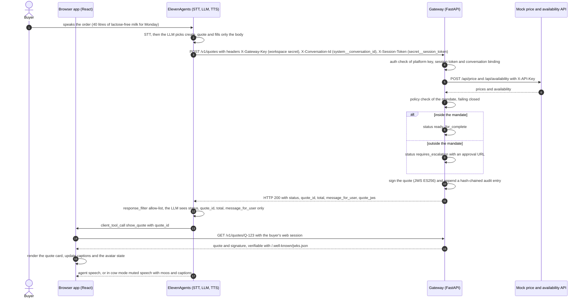

# Technical research: Trusted Trade Agents stack

**Friday 13 Nov 2026** · Junction 2026, Valio Aimo challenge · Companions: [data and API findings](data-and-api-findings.md) (catalogue, mock API, search design) and [PLAN.md](PLAN.md) (build plan).

## 1. Scope and verification

**Scope.** Choices, limits and gotchas for the 40-hour build: the FastAPI agent gateway (MCP and REST tools for search, price and availability, signed quotes, mandates, approval, orders and a hash-chained audit trail over the challenge's mock API), the ElevenAgents voice agent that calls it through webhook tools, the React/Vite/TypeScript app with a lip-synced 2D avatar, and cow mode. Data and mock-API facts stay in the data findings.

**Verification.** Five research tracks read official docs, specs and package registries on 13 Nov 2026 and ran code locally; no ElevenLabs API call was made. An independent check per track re-read every source, re-ran the sketches and listed missed facts. Here, *(corrected)* marks a claim the check corrected, important missed facts are folded in, and the sketches are fixed and re-checked: `tsc --strict` against `@elevenlabs/react` 1.22.1, and Python compiled and smoke-tested with FastAPI, `mcp` 2.3.0 and joserfc. JSON configs follow the published schema but were not pushed to a live workspace. The only factual conflict between inputs (Business-plan concurrency) was re-checked online: ElevenLabs' own pages disagree.

| Track | Facts checked | Confirmed | Partially, corrected | Sketch issues | Missed facts |
|---|---:|---:|---:|---:|---:|
| ElevenAgents platform | 66 | 62 | 4 | 14 | 12 |
| React SDK and avatar | 54 | 51 | 3 | 13 | 18 |
| Cow mode audio | 50 | 48 | 2 | 17 | 12 |
| Python stack and deployment | 38 | 32 | 6 | 9 | 13 |
| Open standards | 85 | 78 | 7 | 9 | 16 |
| **Total** | **293** | **271** | **22** | **62** | **71** |

Keys are named by role only. In the sandbox an HTTPS proxy injects the challenge API key as `X-API-Key` and the ElevenLabs API key as `xi-api-key`, so code must run without keys in its environment. The LLM is "a Claude model selected in the agent's LLM setting". Paths such as `web/` and `gateway/` are illustrative.

## 2. TL;DR decisions

| Decision | Choice | Why | Section |
|---|---|---|---|
| Where logic lives | All business logic and every control in the gateway; ElevenAgents only hosts STT, LLM and TTS. | Tool calls are unsigned; browser input is user-controlled; prompts and approval prompts are not controls. | [§4](#4-elevenagents-platform), [§8](#8-open-standards-for-trusted-agent-commerce) |
| LLM | A Claude model selected in the agent's LLM setting; reasoning effort none or low; own backup order or none. | Tool use needs a strong model; thinking delays turns; the default cascade switches provider. | [§4](#4-elevenagents-platform) |
| Voice agent to gateway | Webhook tools only; no MCP in the voice path. | ElevenLabs MCP needs a workspace opt-in, approves in the browser, is untested, and is off under Zero Retention Mode. | [§4](#4-elevenagents-platform) |
| Identity | Private agent. The backend mints a WebRTC token (it returns the `conversation_id`), binds buyer and mandate, and passes a session token as `secret__session_token`. Every tool sends `X-Gateway-Key`, `X-Conversation-Id`, `X-Session-Token`; the LLM fills none. | `secret__` values never reach the LLM; `system__user_id` is untrusted. | [§4](#4-elevenagents-platform), [§9](#9-one-voice-tool-call-end-to-end) |
| Tool errors | `tool_error_handling_mode: passthrough`; outcomes as HTTP 200 with `status`, `reason_code`, `message_for_user`; `response_filter` allow-lists. | The default `auto` hides webhook errors from the LLM. | [§4](#4-elevenagents-platform) |
| Client tools | UI only, IDs only; blocking `request_buyer_confirmation` (120 s) whose button posts to the gateway. | The LLM cannot invent prices or approvals. | [§5](#5-react-sdk-and-the-2d-avatar) |
| Config | `@elevenlabs/cli` 1.11.0 configs in the repo; tool URLs `https://{{system__env_gateway_host}}/...`. | Reproducible; one value switches tunnel and PaaS. | [§4](#4-elevenagents-platform) |
| ElevenLabs plan | One paid workspace (Creator: $11 first month, 275 min, 10 calls); iterate in text-only mode. | Free has 15 minutes and is blocked on shared IPs such as venue Wi-Fi. | [§4](#4-elevenagents-platform) |
| Language and voice | English primary, Finnish preset, `language_detection` (confirm with mentors); `eleven_v4_turbo` and a designed Finnish voice set explicitly; `eleven_flash_v2_5` fallback. | Finnish at about 100 ms; doc defaults disagree; Default voices expire 2026-12-31. | [§4](#4-elevenagents-platform) |
| React SDK | `@elevenlabs/react` 1.22.1 pinned exactly; v1 provider API. | Released on day 1; pre-1.0 snippets fail. | [§5](#5-react-sdk-and-the-2d-avatar) |
| Avatar | SVG and one rAF loop writing CSS variables; mouth from output frequency bands; alignment visemes only later. | Works on WebRTC today; WebRTC alignment timing is undocumented. | [§5](#5-react-sdk-and-the-2d-avatar) |
| Cow mode | Same agent and branch: `volume: 0`, captions, SFX v3 moos chosen from the gateway's `status`. Demo on desktop Chrome with a headset. | Same controls by construction; no custom server-side audio; iOS ignores media volume. | [§6](#6-cow-mode-audio) |
| MCP server | `mcp==2.3.0` `MCPServer` in FastAPI at `/mcp`: `json_response`, `stateless_http`, explicit hosts and origins, `GET /mcp` → 405, a bearer key per external agent. | v2 renamed FastMCP; the Host check returns 421 behind tunnels; tunnels buffer SSE. | [§7](#7-python-gateway-stack-and-deployment) |
| Hosting | Always-on PaaS for judging; ngrok static domain as laptop backup; Cloudflare quick tunnel for development only. | Cold starts exceed the 20 s / 30 s tool timeouts; quick-tunnel URLs change every run. | [§7](#7-python-gateway-stack-and-deployment) |
| Search | Index built offline by streaming; every `MATCH` token quoted; trigram and rapidfuzz fallback. | Raw strings crash FTS5; `json.load` needs about 600 MB. | [§7](#7-python-gateway-stack-and-deployment) |
| Signatures | Compact JWS, ES256 (joserfc), over RFC 8785 JSON; money as decimal strings; JWKS at `/.well-known/jwks.json`. | UCP verifiers must support ES256; AP2 wants non-deterministic signatures; PyJWT rejects `alg: Ed25519`. | [§8](#8-open-standards-for-trusted-agent-commerce) |
| Mandates and approval | AP2-shaped open mandate evaluated in code, failing closed; approval is gateway state bound to the quote hash; UCP statuses (`requires_escalation` plus an approval URL). | AP2 demands deterministic validation; elicitation and ElevenLabs approvals cannot carry it. | [§8](#8-open-standards-for-trusted-agent-commerce) |
| Audit | Hash chain written in the same transaction as each change; signed quotes and receipts; HMAC-verified post-call webhooks linked by `conversation_id`. | Tamper-evident, checkable with public keys; OTel spans are sampled. | [§8](#8-open-standards-for-trusted-agent-commerce) |
| Standards claims | Implement MCP and OpenAPI; "aligned with UCP and AP2"; schema.org/GS1 product JSON-LD; A2A card only with a real endpoint; Peppol UBL as a stretch. | These standards are consumer-oriented and moving; expert judges punish over-claiming. | [§8](#8-open-standards-for-trusted-agent-commerce) |
| Compliance | AI and recording notice spoken and on screen, both personas; retention 30 days or less; no voice biometrics. | EU AI Act Art. 50 applies since 2 Aug 2026; the ElevenAgents terms require it. | [§8](#8-open-standards-for-trusted-agent-commerce) |

## 3. Version pins

| Package | Version | Note |
|---|---|---|
| **Python** | | |
| Python | 3.13 | Research used 3.13.18; FastAPI needs 3.11+. |
| fastapi | 0.162.7 | Six patch releases since 7 Nov: lock now. |
| starlette / uvicorn[standard] | 1.10.0 / 0.54.0 | Resolved together without conflicts (uv 0.11.32). |
| pydantic / pydantic-settings | 2.14.3 / 2.16.3 | `Decimal` serialises as a string. |
| mcp | 2.3.0 | Official SDK; pulls httpx2 2.16.0, sse-starlette 3.7.0, pyjwt 2.15.1. Use `MCPServer`. |
| httpx / anyio | 0.28.1 / 4.16.0 | |
| elevenlabs | 2.78.0 | Token minting, SFX and Voice Design scripts. |
| joserfc / cryptography | 1.8.0 / 50.0.2 | JWS ES256. |
| rfc8785 | 0.1.4 | JCS; rejects `Decimal`, NaN, ints above 2^53. |
| rapidfuzz / ijson | 3.14.6 / 3.6.0 | Fuzzy re-rank; streaming catalogue parse. |
| opentelemetry-sdk, -exporter-otlp / -instrumentation-fastapi | 1.45.2 / 0.66b2 | GenAI conventions still "Development". |
| http-message-signatures, a2a-sdk, ucp-sdk | 3.0.0, 1.3.0, 0.5.0 | Optional or stretch only. |
| SQLite (system) | 3.53.1 locally | Trigram `remove_diacritics` needs 3.45+: check the image. |
| *Avoid* | | `mcp.server.fastmcp` (gone), PrefectHQ `fastmcp` 4.x, `fastapi-mcp` 0.4.0, python-jose (no EdDSA), Unidecode (GPL), jwcrypto (LGPL), PyPI `ap2` (not Google's), `sd-jwt` 0.10.4 (pre-RFC 9901). |
| **JavaScript** | | |
| @elevenlabs/react | 1.22.1 exact | Pins @elevenlabs/client 1.36.1 (re-exported, do not add a second copy). Fallback 1.22.0 / 1.36.0. |
| react, typescript | ≥ 16.8 peer, 5.9.3 | Sketches checked with @types/react 19.3. |
| @dicebear/open-peeps + core | 9.4.2 + 9.4.x | Optional CC0 art; core 10.x does not match. |
| @rive-app/react-canvas, lottie-react | 4.39.0, 3.1.2 | Rive only with an experienced rigger; Lottie for decorative loops. |
| Vite | not pinned here | Any version serves `public/` at the site root. |
| **CLI** | | |
| @elevenlabs/cli | 1.11.0 | `elevenlabs`; configs as code plus `elevenlabs <resource> <method>`. |
| @modelcontextprotocol/inspector | 2.15.0 | Node ^22.23.4, ^24.22.1 or 26.12.1+. |
| mcp-remote, Node.js | 0.16.6, 22.23.4 | stdio bridge for Claude Desktop; Node used for the checks. |

## 4. ElevenAgents platform

### How we use it

One private agent runs each call: ElevenLabs hosts STT, a Claude model selected in the agent's LLM setting, and TTS. Every business operation is a **webhook tool** carrying three headers the LLM never fills; **client tools** only drive the UI. The backend mints a conversation token per call and binds its `conversation_id` to buyer and mandate first. Agent, tool and test configs live in the repo and are pushed with the CLI. A signed **post-call webhook** feeds the audit store.

### Key facts

- **LLM.** Claude, Gemini, GPT and hosted open models are native; set `agent.prompt.llm` and check `GET /v1/convai/llm/list` for usable models and reasoning efforts [LLM][llm] [OpenAPI][oa]. The default backup cascade mixes providers and may change; `backup_llm_config` can be `override` or `disabled` [cascade][cascade]. HTTP 400s with the newest Claude models were fixed only on 2026-11-09 [changelog][cl1109]. Realtime voice models cannot use a chosen LLM such as Claude [realtime][realtime].
- **Finnish.** `agent.language` plus `language_presets`: the dashboard translates preset first messages, CLI and API examples write them by hand *(corrected)*; the language is fixed per call unless `language_detection` is attached [language][lang]. Finnish TTS: `eleven_v4_turbo` (API default since 2026-10-05, about 100 ms, expressive tags), `eleven_v4`, `eleven_v3_conversational` (about 165 ms), `eleven_multilingual_v2`, `eleven_flash_v2_5` (about 100 ms, the only one with speed control). `eleven_flash_v2` is English only, yet the language page still calls it the default [create][create] [models][models] [latency][latency]. Flash v2.5 does not normalise numbers or currency; `text_normalisation_type: elevenlabs` does.
- **Voices.** Default voices expire 2026-12-31 and are unavailable to accounts created after March 2026 [default voices][defvoices]. Voice Design returns 3 previews (`eleven_ttv_v3`, `seed`); saving uses a voice slot; start the prompt with "Native Finnish (Finland)"; it is "still experimental" and "may be less performative" on v4 [Voice Design][vd].
- **Webhook tools.** Each parameter has one source (LLM, dynamic variable, system value, constant, omitted); `allowed_values` rejects LLM values outside a gateway-supplied list [tools API][toolapi]. Headers come from workspace secrets, dynamic or environment variables; there is no OpenAPI import [webhook tools][webhook]. Timeouts: webhook 5–300 s (default 20), client 1–120 s (20) or −1, MCP 5–300 s (30); error mode `auto` hides errors for our tools [OpenAPI][oa]. Redirects are followed only as a header-less GET. Editing a tool changes every agent and branch at once [editing][editing].
- **Identity.** `secret__` variables reach headers only, never the LLM; the API shows them `<REDACTED>`, but post-call webhooks deliver them in clear. `system__user_id` "must not be trusted for authentication" [dynamic variables][dv]. Initiation webhooks skip SDK sessions [personalization][pers]. Tool calls are unsigned; egress IPs are static (US 34.67.146.145, 34.59.11.47; EU 35.204.38.71, 34.147.113.54) [IPs][ip].
- **Private agent.** `enable_auth` plus a WebRTC conversation token (`GET /v1/convai/conversation/token` → `{token, conversation_id}`) or a WebSocket signed URL (start within 15 min, no conversation id) [auth][auth] [token][token]. Origin allowlists must not be combined with tokens and `require_origin_header` needs one, so the token is the only gate *(corrected)*. Overrides are off per field; disabled ones error except ASR keywords [overrides][overrides]. Environment variables resolve per the token's `environment`; the Python SDK has them at `client.environment_variables` [env vars][envvars].
- **MCP on ElevenLabs.** SSE (default) or streamable HTTP; off per workspace until `can_use_mcp_servers`; unavailable under Zero Retention Mode; approvals happen in the browser; a docstring change sets `needs_review`; the guide's `always_ask` is not a valid value. The CLI cannot sync MCP servers, but its raw `elevenlabs <resource> <method>` commands can create them *(corrected)* [MCP][elmcp] [CLI][cli].
- **Events and audit.** Client events must be enabled; a hand-written list replaces the defaults [client events][events]. Post-call webhooks carry transcript, tool calls, analysis and variables, signed `ElevenLabs-Signature: t=…,v0=…` (HMAC-SHA256 over `t.body`, 30-minute tolerance); retries resend the same payload; a per-agent override needs an HMAC workspace webhook created by an admin [post-call][postcall] [SDK][pypiel].
- **Config and tests.** CLI 1.11.0 keeps agents, tools and tests as raw API JSON, YAML or TOML; all agents are versioned with branches [CLI][cli] [versioning][versioning]. Tests (simulations with mocked tools, next reply, tool call) run with `repeat_count` 2–20 and `branch_id`, and must be attached before `elevenlabs agents test` runs them [testing][testing]. Text-only mode needs no microphone and is billed per message [chat mode][chat].
- **Plans** [pricing][pricing] [chat mode][chat]: Free 15 min / 4 calls; Starter $6 ($1 first month) 75 / 6; Creator $22 ($11) 275 / 10; Pro $99 1,238 / 20; Scale $299 3,738 / 30; Business $990 12,375 min with 40 calls on the pricing page but 30 in the chat-mode guide. Chat concurrency is 25× voice. Extra minutes $0.08, burst $0.16; LLM on top; connection time is billed, idle tabs included. Bursting is on (3× concurrency, max 300, double rate) and new agents queue excess callers for up to 180 s instead of rejecting them *(corrected)* [burst][burst] [queueing][queue]. Free accounts get blocked on shared IPs [abuse][abuse]; EU residency is Enterprise only [residency][residency].

### Gotchas and risks

- **Day-1 smoke test** with a stub that logs headers: does `system__conversation_id` equal the token's `conversation_id` (undocumented)? Do header references resolve for `system__` and `secret__`? Does `secret__` stay out of the LLM? Do passthrough errors reach the agent? Do client tools fire? Does the platform retry on timeout?
- Passthrough bodies may be read aloud: keep them short and safe. `{{system__env_gateway_host}}` fails unless the workspace variable `gateway_host` exists with a production value.
- Everything from the browser is user-controlled: dynamic variables, enabled overrides, `userId`, client-tool results, MCP approvals, contextual updates, `toolMockConfig`. Keep prompt, LLM and tool overrides off and browser text out of the prompt.
- Redact `secret__` values from webhook payloads. The LLM may call `place_order` twice, so the gateway derives the idempotency key from `conversation_id` and `quote_id`. Blocking client tools time out after 20 s unless set to 120 or −1.
- Append to `client_events` after pulling the live config: keep `audio`, `interruption`, `agent_response`, add `client_tool_call`, and (an inference) keep `conversation_initiation_metadata` and `ping`.
- Tool edits apply everywhere at once: use dev tools or a dev environment.
- Finnish latency stacks STT, LLM, gateway and TTS: gateway p95 under 1 s, caching, a 3 s soft-timeout filler ("Hetkinen…"), tool-call sounds, `pre_tool_speech: force` on slow tools.
- Pin the model, set the backup order and re-run tests before the demo. Low confidence: if newer Claude models fail with HTTP 400, set `temperature` to null. A runtime `textOnly` override needs its Security toggle and the `agent_response` event.
- If MCP is ever used: the `secret_token` "Bearer " prefix is undocumented (the MCP SDK requires it), and ElevenLabs lists tools outside any conversation, so use a static secret for transport auth; test with `GET /v1/convai/mcp-servers/{id}/tools`.
- The docs disagree on the default voice model, versioning and concurrency: read the real state with `elevenlabs agents pull`.

### Code sketches

**Agent config excerpt** (`agent_configs/valio-buyer.json`; merge into the pulled config):

```json
{
  "conversation_config": {
    "agent": {
      "language": "en",
      "first_message": "Hi, I'm Valio Aimo's AI ordering assistant. This call is recorded and processed by our service providers. How can I help?",
      "prompt": {"llm": "<a Claude model id from GET /v1/convai/llm/list>", "reasoning_effort": "none",
                 "timezone": "Europe/Helsinki", "backup_llm_config": {"preference": "override", "order": ["<second model>"]}}
    },
    "language_presets": {"fi": {"overrides": {"agent": {"first_message": "Hei, olen Valio Aimon tekoälyavustaja. Puhelu tallennetaan, ja sitä käsittelevät palveluntarjoajamme. Miten voin auttaa?"}}}},
    "tts": {"model_id": "eleven_v4_turbo", "voice_id": "<designed Finnish-capable voice>"},
    "turn": {"interruption_ignore_terms": ["moo", "muu", "mu"],
             "soft_timeout_config": {"timeout_seconds": 3.0, "message": "Hetkinen...", "use_llm_generated_message": false}},
    "conversation": {"max_duration_seconds": 900, "client_events": ["conversation_initiation_metadata", "ping", "audio",
      "interruption", "user_transcript", "agent_response", "agent_response_correction", "agent_chat_response_part",
      "client_tool_call", "agent_tool_request", "agent_tool_response", "agent_tool_response_full_payload", "vad_score"]}
  },
  "platform_settings": {
    "auth": {"enable_auth": true},
    "overrides": {"conversation_config_override": {"agent": {"language": true}, "conversation": {"text_only": true}}},
    "privacy": {"retention_days": 30, "record_voice": false}
  }
}
```

Fixed against the research: no hard-coded model ID, `client_tool_call` added, text-only override enabled for the typed fallback, no browser-supplied variable in the prompt, disclosure in both first messages, voice and first-message overrides removed.

**Webhook tool** (`tool_configs/place_order.json`):

```json
{
  "type": "webhook", "name": "place_order",
  "description": "Turn a confirmed quote into an order. Call ONLY after create_quote returned a quote_id AND request_buyer_confirmation returned 'confirmed'. Read message_for_user to the buyer.",
  "response_timeout_secs": 15, "pre_tool_speech": "force", "interruption_mode": "disable_during_tool_and_turn",
  "tool_error_handling_mode": "passthrough", "tool_call_sound": "typing",
  "api_schema": {
    "url": "https://{{system__env_gateway_host}}/v1/orders", "method": "POST", "content_type": "application/json",
    "request_headers": {
      "X-Gateway-Key": {"secret_id": "<workspace secret id>"},
      "X-Conversation-Id": {"variable_name": "system__conversation_id"},
      "X-Session-Token": {"variable_name": "secret__session_token"}
    },
    "request_body_schema": {"type": "object", "required": ["quote_id"], "properties": {
      "quote_id": {"type": "string", "description": "quote_id exactly as returned by create_quote. Never invent or edit it."}}},
    "response_filter": {"mode": "allow", "filters": ["status", "order_id", "reason_code", "message_for_user", "total_eur"]}
  }
}
```

**Gateway side** (`gateway/voice.py`): mint and bind, authenticate every tool call, verify the post-call webhook. Tested with stubs: a valid call passes, a wrong conversation gets 403, a wrong key 401, a signed-URL session binds once, a bad, stale or missing signature 401, and `secret__` values are redacted.

```python
import hashlib, hmac, json, os, secrets, time
import httpx
from fastapi import APIRouter, Depends, Header, HTTPException, Request

router = APIRouter()
AGENT_ID = os.environ["ELEVENLABS_AGENT_ID"]
XI_KEY = os.environ.get("ELEVENLABS_API_KEY")  # unset in the sandbox: the proxy injects xi-api-key
PLATFORM_KEY = os.environ["GATEWAY_PLATFORM_KEY"]  # same value saved as an ElevenLabs workspace secret
WEBHOOK_SECRET = os.environ["ELEVENLABS_WEBHOOK_SECRET"]
sha = lambda s: hashlib.sha256(s.encode()).hexdigest()

@router.post("/api/voice/session")
async def voice_session(buyer=Depends(current_buyer)):  # the buyer's own web login
    async with httpx.AsyncClient(timeout=10) as c:
        r = await c.get("https://api.elevenlabs.io/v1/convai/conversation/token", params={"agent_id": AGENT_ID},
                        headers={"xi-api-key": XI_KEY} if XI_KEY else {})
    if r.status_code != 200:
        raise HTTPException(502, "voice service unavailable")
    body, token = r.json(), secrets.token_urlsafe(32)  # body: {"token", "conversation_id"}
    repo.create_session(token_hash=sha(token), buyer_id=buyer.id, mandate_id=repo.active_mandate(buyer.id).id,
                        conversation_id=body["conversation_id"], expires_at=time.time() + 1800)
    return {"conversationToken": body["token"], "sessionToken": token, "pseudonym": buyer.pseudonym}

async def agent_session(x_gateway_key: str = Header(), x_conversation_id: str = Header(),
                        x_session_token: str = Header()):  # dependency of every webhook-tool route
    if not hmac.compare_digest(x_gateway_key.encode(), PLATFORM_KEY.encode()):
        raise HTTPException(401, "unknown caller")
    s = repo.session_by_hash(sha(x_session_token))
    if s is None or s.expires_at < time.time():
        raise HTTPException(401, "This call has expired. Please start a new call.")  # read aloud
    if s.conversation_id is None:  # signed-URL fallback: bind on first use (atomic UPDATE)
        s = repo.bind_conversation_once(s, x_conversation_id)
    if s.conversation_id != x_conversation_id:
        raise HTTPException(403, "This call is not linked to your session.")
    return s  # buyer and mandate come from here, never from the LLM

@router.post("/webhooks/elevenlabs")
async def post_call(request: Request):
    raw = await request.body()  # verify the raw bytes before parsing
    parts = dict(p.split("=", 1) for p in request.headers.get("elevenlabs-signature", "").split(",") if "=" in p)
    ts, sig = parts.get("t", ""), parts.get("v0", "")
    mac = hmac.new(WEBHOOK_SECRET.encode(), ts.encode() + b"." + raw, hashlib.sha256).hexdigest()
    if not ts.isdigit() or abs(time.time() - int(ts)) > 1800 or not hmac.compare_digest(mac, sig):
        raise HTTPException(401, "bad signature")
    event = json.loads(raw)
    if event.get("type") == "post_call_transcription":
        data = event["data"]
        dv = (data.get("conversation_initiation_client_data") or {}).get("dynamic_variables") or {}
        dv.update({k: "<redacted>" for k in dv if k.startswith("secret__")})  # they arrive in clear
        audit.upsert_conversation(data["conversation_id"], data)  # retries resend the same payload
    return {"ok": True}
```

Changed from the research: an opaque, hashed, revocable session token instead of a JWT; bind-on-first-use for signed-URL sessions; 502 instead of a bare 500; redaction; the key header only when configured.

### Open questions

ElevenLabs: EL-1, EL-3 to EL-6, EL-8, EL-13. Team: T-1, T-3, T-4. Mentors: M-1, M-3. Details in [§11](#11-open-questions).

## 5. React SDK and the 2D avatar

### How we use it

One `<ConversationProvider>` wraps the voice UI. Its callbacks feed a small external store; the avatar's rAF loop reads SDK getters directly and writes CSS variables, so React never re-renders per frame. An always-mounted bridge registers the client tools, which pass IDs only; components fetch products, quotes and approvals from the gateway with the buyer's session. A text box is always visible, and a fallback ladder covers blocked microphones and networks.

### Key facts

- **v1 API.** Since March 2026 every hook needs a `ConversationProvider`; use the granular hooks (`useConversationControls` has stable functions and never re-renders) and `useConversationClientTool`; `useConversation` re-renders on every change [v1 changelog][cl0323] [React docs][react].
- **Surprises in 1.22.1.** `startSession()` returns `void` although the docs `await` an id: read the id in `onConnect` and failures in `onError`. `useConversation().message` is the error string. Controls throw "No active conversation" until connected and getters return an empty array or 0; `setVolume` throws in text sessions; `startSession` silently does nothing while a start is pending and throws if a hook and the provider register the same tool [controls][ctrl] [provider][prov].
- **Session.** A token means WebRTC, a signed URL WebSocket; `dynamicVariables` take scalars only. Provider, hook and `startSession` callbacks all run, composed at `startSession`, so hooks that add callbacks must be mounted before the call. `onDisconnect` reports `error` (with `closeCode`), `agent` (for example `end_call`) or `user` [types][types].
- **Mode** is only `speaking` or `listening`. Agent audio switches to speaking at once (on WebSocket before it is audible) and an interruption to listening; WebSocket then follows playback, WebRTC follows LiveKit active-speaker changes *(corrected)* [VoiceConversation][voiceconv].
- **Audio signals.** `getOutputByteFrequencyData()` gives 1024 bytes over 100–8000 Hz (bin i ≈ 100 + 7.7·i Hz; fftSize 2048, smoothing 0.8); `getOutputVolume()` is 0–1 (−100 to −30 dB) [volume][vol]. Alignment comes per audio chunk as characters with start times and durations, with no phonemes [client events][events]. `onAudioAlignment` fires on arrival; client 1.15.2+ forwards it on WebRTC, but the events page says WebRTC sends no audio events and nothing documents the timing, so measure first; `onAudioAlignmentPlayback` is WebSocket only *(corrected)* [changelog][cl0727].
- **Captions.** `agent_response` arrives after the audio starts, so build live captions from `agent_chat_response_part` (enable it), keyed by `response_id`; `agent_response_correction` trims text after a barge-in, also by `response_id`. `stripAudioTags` cleans `onMessage` only and skips tags with punctuation such as `[half-laughing]` [changelog][cl1026]. Add typed user messages locally; they may not echo back.
- **Client tools.** The return value goes to the agent; a throw is sent as `is_error` and also fires `onError`; an unregistered name returns an error. The SDK's typed `useConversationClientTool<Tools>` example fails TypeScript strict (TS2344): use untyped handlers with runtime checks (local check). React handles MCP approvals with `onMCPToolCall` and `sendMCPToolApprovalResult` [React types][rtypes].
- **Microphone and typing.** Voice always calls `getUserMedia` (echo cancellation, noise suppression, auto gain) and needs HTTPS or localhost. Errors: `NotAllowedError` (Firefox also for insecure contexts), `NotFoundError`, `NotReadableError`. `permissions.query` for the microphone works in Chromium, Safari 16+ (may report `prompt` for a denied site) and Firefox 132+ *(corrected)* [MDN][mdngum] [Mozilla][moz]. `sendUserMessage(text)` is a user turn, `sendContextualUpdate` silent context, `sendUserActivity` a ~2 s pause [client-to-server][c2s]. Chat sessions count against total concurrency at handshake, so the text fallback can be refused when voice is full [chat mode][chat].
- **Browsers.** A strict CSP needs `workletPaths` of the same version and `libsampleratePath` (or `cdn.jsdelivr.net`) [client README][creadme]. On iOS the WebRTC analyser context is created without `resume()`: check that the mouth moves on an iPhone [audioUnlock][unlock].
- **Driver recipe** (from the research sketch, which type-checks): bands 150–900, 900–2500 and 2500–8000 Hz weighted 0.6/0.3/0.1; auto-gain from a decaying peak; 40 ms attack and 90 ms release; mouth shape (M, A, E, O, F) from band ratios with 3-frame hysteresis; blink 120 ms every 2–5 s. Write `--mouth-open` and `data-mouth` on the SVG root; check `matchMedia('(prefers-reduced-motion: reduce)')` in the loop, because CSS media queries do not stop rAF.
- **Alternatives.** LiveAvatar (HeyGen) renders a photoreal avatar but bypasses our client tools [LiveAvatar][liveavatar]; the experimental avatar-video hooks are undocumented. Art: DiceBear Open Peeps CC0 faces give mouth frames [open-peeps][peeps]; Rive has a free-plan splash, deprecated Inputs, 2.2 MB of WASM and unmergeable files [Rive][rive]; the ElevenLabs UI Orb is a plan B [ElevenLabs UI][elui].

**Avatar states:** idle (not live) · connecting (after `startSession`, before `onConnect`) · listening · userSpeaking (`vad_score` > 0.5) · thinking (a gateway tool in flight, matched by `tool_name`, or more than 1 s after the user's turn without agent audio; 15 s watchdog; `agent_response_complete` via `onIncomingEvent` ends a turn) · speaking (`mode` or output energy) · error (`onDisconnect` with reason `error`).

### Gotchas and risks

- Any `onError` (thrown tool, unknown tool, non-fatal server error) sets `useConversationStatus()` to `'error'` while the call stays open, and a mid-call drop ends as `'disconnected'`. Derive "live" from `onConnect`/`onDisconnect`, toast errors, return error strings from tools (runtime-tested).
- A blocking tool's promise must settle on replacement, disconnect and unmount, or the agent waits (forever with −1).
- Call queueing is on by default: a queued session is "connected" and its hold audio arrives as agent audio, so the avatar mouths it; `queue_status` reaches only `onIncomingEvent`; a timeout closes with code 4300 [queueing][queue].
- Fallback ladder: WebRTC, then `webRtc.iceTransportPolicy: 'relay'`, then a signed-URL WebSocket, then text-only. Call `endSession()` and wait for `onDisconnect` between attempts, with fresh credentials each time. UDP-blocking venue Wi-Fi breaks WebRTC: keep a phone hotspot.
- WebRTC lip-sync is approximate: no playback events, speaker-detection lag, about 60–110 ms analyser lag (estimate). Fine for a cartoon.
- Later visemes: a/ä→A; e/i→E; o/ö/u/w/å/y/ü→O (Finnish y is rounded, not E); m/b/p→M; f/v→F; space and punctuation→M. Schedule chunks at `max(arrival + offset, previous end)` and clear them on interruption.
- Docs drift: `await startSession()`, `sendUserMessage({text})`, `message.type === 'agent_response'` and `await getInputVolume()` are wrong for 1.22.1.
- `userId` becomes `system__user_id`: send a pseudonym, never a name. Use a headset at the booth.

### Code sketches

Both type-check under `tsc --strict` with `@elevenlabs/react` 1.22.1; `signals` and `upsertAgentTurn` are a small `useSyncExternalStore` store, not shown.

**Provider wiring and session start** (`web/src/agent/AgentRoot.tsx`):

```tsx
import { useCallback, type ReactNode } from "react";
import { ConversationProvider, useConversationControls, type Conversation } from "@elevenlabs/react";
import { signals, upsertAgentTurn } from "./agentSignals";

const GATEWAY_TOOLS = new Set(["search_products", "create_quote", "place_order"]);

export function AgentRoot({ children }: { children: ReactNode }) {
  return (
    <ConversationProvider
      // 'live' from connect/disconnect: status turns 'error' on any onError while the call stays open
      onConnect={({ conversationId }) => signals.setUi({ live: true, conversationId, turns: [] })}
      onDisconnect={d => {
        signals.setUi({ live: false, pendingTools: [], lastError: d.reason === "error" ? d.message : undefined });
        signals.emitDisconnect(); // settles pending confirmations
      }}
      onError={message => signals.setUi({ toast: message })} // often non-fatal: toast, keep the call
      onAgentChatResponsePart={p => { // live captions, keyed by response_id
        if (p.type === "delta") upsertAgentTurn(p.response_id ?? "draft", t => ({ text: t.text + p.text }));
      }}
      onAgentToolRequest={t => { // 'thinking' only while a gateway call runs
        if (GATEWAY_TOOLS.has(t.tool_name)) signals.setUi(s => ({ pendingTools: [...s.pendingTools, t.tool_call_id] }));
      }}
      onAgentToolResponse={t => // may fire twice per call
        signals.setUi(s => ({ pendingTools: s.pendingTools.filter(id => id !== t.tool_call_id) }))}
    >{children}</ConversationProvider>
  );
}

export function useStartTalk() {
  const { startSession } = useConversationControls();
  return useCallback(async (cow: boolean) => {
    const r = await fetch("/api/voice/session", { method: "POST", credentials: "include" });
    if (!r.ok) throw new Error(`voice session ${r.status}`);
    const c = (await r.json()) as { conversationToken: string; sessionToken: string; pseudonym: string };
    startSession({ // returns void: success is onConnect, failure is onError / onDisconnect
      conversationToken: c.conversationToken, // private agent over WebRTC
      userId: c.pseudonym, // opaque, analytics only, never auth
      dynamicVariables: { secret__session_token: c.sessionToken }, // tool headers only, never the LLM
      ...(cow ? { onConversationCreated: (conv: Conversation) => conv.setVolume({ volume: 0 }) } : {}),
    });
  }, [startSession]);
}
```

**Blocking confirmation tool** (`web/src/agent/AgentUiBridge.tsx`):

```tsx
import { useEffect, useRef, useState, type ReactElement } from "react";
import { useConversationClientTool } from "@elevenlabs/react";
import { signals } from "./agentSignals";

export function AgentUiBridge() { // mount once, for the whole session
  const [quoteOnScreen, setQuoteOnScreen] = useState<string | null>(null);
  const pending = useRef<((answer: string) => void) | null>(null);
  const settle = (answer: string) => { pending.current?.(answer); pending.current = null; setQuoteOnScreen(null); };

  // show_products and show_quote follow the same pattern (expects_response false, IDs only).
  // Return error strings instead of throwing: a throw also fires onError and flips status to 'error'.
  useConversationClientTool("request_buyer_confirmation", params => { // expects_response, 120 s
    const quoteId = params.quote_id;
    if (typeof quoteId !== "string" || !quoteId) return "error: quote_id is required";
    settle("cancelled: replaced by a newer request");
    return new Promise<string>(resolve => { pending.current = resolve; setQuoteOnScreen(quoteId); });
  });
  useEffect(() => signals.onDisconnect(() => settle("cancelled: call ended")), []);
  useEffect(() => () => settle("cancelled: screen closed"), []);

  // ConfirmQuote POSTs /v1/quotes/{id}/confirm with the buyer's own web session, then reports back
  return quoteOnScreen ? <ConfirmQuote quoteId={quoteOnScreen}
    onDone={r => settle(r.ok ? `confirmed, gateway reference ${r.ref}` : "declined by the buyer")} /> : null;
}
declare function ConfirmQuote(p: { quoteId: string; onDone: (r: { ok: boolean; ref?: string }) => void }): ReactElement;
```

### Open questions

ElevenLabs: EL-7 to EL-9, EL-11. Team: T-6, T-7. Mentors: M-1. Details in [§11](#11-open-questions).

## 6. Cow mode audio

### How we use it

Cow mode is a renderer switch on the same agent, branch, prompt, tools and gateway. The browser sets the agent's output volume to 0, captions show the real words, and a Web Audio player plays pre-generated moos whose mood comes from the gateway's `status` in tool results. The cow's mouth follows the moo audio. Moos are generated once offline with SFX v3 and committed with a manifest and a provenance file.

### Key facts

- **Sound Effects API.** `POST /v1/sound-generation` takes `text`, `model_id`, `duration_seconds` (0.5–30 s in the API; the overview says 0.1), `prompt_influence` (default 0.3), `loop` and `output_format` (default MP3 44.1 kHz) [SFX API][sfxapi]. Set `eleven_text_to_sound_v3`: v2 is still the default but is removed on 2027-03-01; v3 reached all workspaces on 2026-11-02 [models][models] [changelog][cl1102]. Describe action and setting; counts such as "moo twice" are not followed [SFX guide][sfx]. SFX concurrency is 4 to 8 by plan, with 429 beyond [changelog][cl1109]. Price $0.12 per generated minute; Starter includes 150 generations [API pricing][apipricing].
- **Licence.** The free plan has no commercial licence and needs attribution; paid plans include one except for Beta Services [publishing][publish]. ElevenLabs watermarks generated audio [watermark][watermark].
- **No server-side moo.** Tool-call and background sounds are presets only, with no upload or per-call override [tool-call sounds][toolsounds]. v4 audio tags can make sound effects but unreliably [TTS best practices][ttsbp]; multi-voice `<Cow>` tags depend on the LLM [multi-voice][multivoice].
- **Muting.** `setVolume` sets `HTMLAudioElement.volume` on WebRTC and a GainNode on WebSocket (worklet → gain → analyser → hidden `<audio>`) *(corrected)* (local check). iOS ignores `.volume` but honours `.muted`, so an iPhone or iPad needs the WebSocket transport or a hack on SDK internals [MDN volume][mdnvol] [WebKit][wk241657]. On WebRTC `getOutputVolume()` still follows the muted speech; on WebSocket it reads about 0. No initial-volume option exists: pass `onConversationCreated` (§5 sketch).
- **Browser audio.** Resume the AudioContext in the Start click [autoplay][autoplay]. iPhones silence Web Audio with the ring switch unless `navigator.audioSession.type = 'playback'` (Safari 17+) [WebKit][wk237322]. Chrome-wide echo cancellation (default "in most cases" since about Chrome 106) reportedly also cancels Web Audio playback on desktop Chrome; Edge and others may not; low confidence *(corrected)* [Chromium][craec].
- **Barge-in.** `turn.interruption_ignore_terms` (exact match) keeps "moo" and "muu" from interrupting the agent, but a moo heard while it listens still becomes a user turn; "muu" is also Finnish for "other" [create][create] [conversation flow][flow].
- **Mood timing.** Tool results arrive before the agent talks about them, so alarmed and celebratory moos are dependable; reply text arrives late, so the "question" mood must come from streamed parts. Full tool payloads carry `is_error`, `is_blocked` and `truncated` (64 KB) and fire twice if both tool events are on [client events][events].
- **Assets.** The generation script sets `model_id` explicitly, makes 4 takes per mood (greet, happy, question, alarmed, celebrate, and a looping chewing "thinking"), uses 1.4–6 s one-shot prompts with `prompt_influence` about 0.6, retries on 429 (`ApiError.status_code`) and writes `manifest.json` plus `PROVENANCE.json` to `web/public/sfx/moo` (served at `/sfx/moo/`). The player keeps one AudioContext with two channels (moos and the chewing loop), decodes on page load, resumes in the click, and exposes an analyser for the mouth.
- **Talking cow (optional).** A `cow` branch selected by `branch_id` at token time shares tool definitions, but versioned `platform_settings` (overrides, guardrails, webhooks) can drift per branch: diff the live configs and run the same tests with `branch_id` [versioning][versioning].

### Gotchas and risks

- The spoken AI disclosure is muted in cow mode: show it on screen and in captions.
- Keep the cow hook mounted all session and toggle it, because listeners compose at `startSession`.
- `setMuted` throws after the call closes: wrap it and restore the user's own mute state.
- Debounce the switch to `listening` (about 400 ms), not only the start, or flicker leaves silence and an open microphone; cap moos at 3 per turn; keep chewing and moos on separate channels.
- Do not map ElevenLabs' MCP `awaiting_approval` prompt to the gateway's escalation.
- Do not await downloads in the Start click. iPadOS 13+ reports a Mac user agent: detect it with `navigator.userAgent.includes("Mac") && "ontouchend" in document`.
- Full tool payloads reach the browser: no secrets, limits or other buyers' data in tool results.
- Keep the cow a toggle with identical cards, captions and audit, so it shows "same guardrails, different skin". Voice Design may count as a Beta Service.

### Code sketches

**Cow mode hook** (`web/src/cow/useCowMode.ts`, `tsc --strict` OK). `MooPlayer` is the two-channel player described above.

```ts
import { useEffect, useRef } from "react";
import { useConversation, stripAudioTags } from "@elevenlabs/react";
import type { MooPlayer, Mood } from "./MooPlayer";

const GATEWAY_TOOLS = new Set(["search_products", "get_offer", "create_quote", "place_order"]);
type ToolEvent = { is_error: boolean; is_blocked?: boolean; truncated?: boolean; full_tool_result?: string };

function moodFromTool(e: ToolEvent): Mood | null { // the gateway decides the mood, not the LLM
  if (e.is_error || e.is_blocked) return "alarmed";
  if (!e.full_tool_result || e.truncated) return null; // cut above 64 KB: do not parse
  try {
    const r = JSON.parse(e.full_tool_result) as { status?: string; reason_code?: string | null };
    if (r.status === "requires_escalation" || r.status === "canceled" || r.reason_code) return "alarmed";
    if (r.status === "completed") return "celebrate";
  } catch { /* not JSON */ }
  return null;
}

// Keep mounted for the whole session and toggle `enabled`: listeners are composed at startSession.
export function useCowMode(enabled: boolean, moo: MooPlayer) {
  const next = useRef<Mood>("greet"), draft = useRef(""), mooing = useRef(false), wasMuted = useRef(false);
  const { mode, isMuted, setMuted } = useConversation({
    volume: enabled ? 0 : 1, // same agent: only its voice is silenced
    onAgentToolRequest: t => { if (enabled && GATEWAY_TOOLS.has(t.tool_name)) moo.startLoop(); },
    onAgentToolResponse: e => { moo.stopLoop(); const m = moodFromTool(e); if (m) next.current = m; },
    onGuardrailTriggered: () => { next.current = "alarmed"; },
    onAgentChatResponsePart: p => { // early text: agent_response comes too late
      draft.current = p.type === "start" ? "" : draft.current + (p.type === "delta" ? p.text : "");
      if (p.type === "stop" && next.current === "happy" && stripAudioTags(draft.current).trim().endsWith("?"))
        next.current = "question";
    },
  });
  const safeMute = (m: boolean) => { try { setMuted(m); } catch { /* call already closed */ } };
  const stopMoo = () => { mooing.current = false; moo.stopOneShot(); safeMute(wasMuted.current); };

  useEffect(() => {
    if (!enabled) { moo.stopLoop(); if (mooing.current) stopMoo(); return; }
    if (mode !== "speaking") { // debounce active-speaker flicker
      const t = setTimeout(() => { if (mooing.current) stopMoo(); }, 400);
      return () => clearTimeout(t);
    }
    if (mooing.current) return;
    mooing.current = true; wasMuted.current = isMuted; safeMute(true); // keep moos out of the mic
    void (async () => {
      for (let i = 0; i < 3 && mooing.current; i++) { // at most 3 moos per turn
        const m = next.current; next.current = "happy";
        await moo.play(m);
        await new Promise(r => setTimeout(r, 350));
      }
    })();
  }, [enabled, mode]);
}
```

Fixed against the research: no throw from `setMuted` at the end of a call, debounced stop, separate chewing channel, early "question" mood, truncated and failed results handled, MCP prompts not treated as escalation, the user's mute state restored.

### Open questions

Team: T-5, T-6. ElevenLabs: EL-12. Details in [§11](#11-open-questions).

## 7. Python gateway stack and deployment

### How we use it

One FastAPI app serves the REST/OpenAPI routes the webhook tools call and an MCP endpoint at `/mcp` for external purchasing agents, both thin adapters over one guarded service layer. It runs on an always-on PaaS instance with a stable HTTPS URL, because ElevenLabs' cloud must reach it; localhost and venue-LAN addresses do not work. The catalogue index is a SQLite file built offline by streaming `products.json`.

### Key facts

- **mcp 2.3.0** (2026-10-02): FastMCP is now `MCPServer`; `mcp.server.fastmcp` raises `ModuleNotFoundError`; `ctx.fastmcp` became `ctx.mcp_server` and `McpError` became `MCPError`. PrefectHQ `fastmcp` and `fastapi-mcp` are different projects [what's new][mcpnew] [PyPI][pypimcp]. One `streamable_http_app()` serves 2025-era clients (handshake, session id) and 2026-07-28 clients (stateless); both verified [legacy clients][mcplegacy].
- **Mounting.** Transport options live on `streamable_http_app()`, not the constructor. A mounted sub-app's lifespan never runs, so FastAPI's lifespan must enter `mcp.session_manager.run()` ("Task group is not initialized" otherwise), and `run()` works once per instance. `Mount("/")` goes last; `/mcp/` redirects; mounting at `/mcp` doubles the path [ASGI][mcpasgi].
- **Host and Origin checks.** Without `transport_security` only localhost Hosts pass: others get a plain-text 421, and a non-listed `Origin` gets 403 (also once `allowed_hosts` is set). Entries are exact with an optional `:*`, no subdomain wildcards, and `localhost:*` does not match a bare `localhost`. A POST without `Content-Type: application/json` gets 400, no `Accept` gets 406 [deploy][mcpdeploy] (local check).
- **Transport.** Replies are SSE unless `json_response=True`; `stateless_http=True` drops session ids. `GET /mcp` opens an endless SSE stream for 2025-era clients; a FastAPI `GET /mcp` → 405 registered before the mount keeps both eras working (local check). Cloudflare quick tunnels buffer SSE.
- **Tools.** The return annotation becomes `outputSchema`; lists are wrapped as `{"result": …}`; the model reads only the text `content` [structured output][mcpstruct]. `ToolError` reaches the model as `isError`; other exceptions become "Error executing tool X" [errors][mcperr]. Sync tools run on worker threads, which breaks thread-bound SQLite connections (local check).
- **Auth.** `TokenVerifier` plus `AuthSettings` give 401 with RFC 9728 metadata and `get_access_token().client_id` inside tools; only `Authorization: Bearer` is accepted; custom routes are never authenticated. The metadata names an authorization server that does not exist, so OAuth-capable clients without a configured header try OAuth and fail [authorization][mcpauth]. On 2026-07-28 connections `ctx.elicit()` fails with `NoBackChannelError`, so approvals cannot use elicitation; the v2 client uses the OS trust store, so minimal containers need `ca-certificates` [what's new][mcpnew].
- **Web stack and SDK.** uvicorn 0.54.0 trusts `X-Forwarded-*` only from 127.0.0.1; behind a PaaS load balancer set `FORWARDED_ALLOW_IPS='*'` or redirects point at `http://` (local check). `get_webrtc_token()` returns `token` and `conversation_id`, `get_signed_url()` only `signed_url`, and the docs' sample awaits the sync client [SDK][pypiel]. Whether a partial `agents.update` merges nested `prompt` fields is unverified: read, modify, write. *(corrected: the CLI can also create MCP servers and environment variables as one-off API calls.)*
- **Search store.** SQLite 3.53.1 has FTS5; `unicode61 remove_diacritics 2` folds ä and ö; trigram finds "maito" inside "kevytmaito", which `maito*` does not, and needs at least 3 characters. `json.load` of the 87 MB catalogue peaks at about 595 MB; a streaming ijson build takes about 3 s at 24 MB into a 12 MB database (local check). Raw `MATCH` input crashes on "valio-maito", "maito 1,5%", "O'Learys", "rasvaton (1l)" and "maito AND". Fold with stdlib `unicodedata`, not GPL Unidecode. The ranking design is in [data findings §5](data-and-api-findings.md#5-search).

**Public URL for webhooks** [Fly][fly] [ngrok][ngrok] [quick tunnels][cfquick] [Render free][renderfree]

| Option | URL | Limits | Use |
|---|---|---|---|
| Always-on PaaS: Fly.io (`auto_stop_machines = "off"`, about $2.19/month for 256 MB, no free tier for new organisations), Railway Hobby with Serverless off, or paid Render | Stable | Needs a card; bind `0.0.0.0:$PORT` | Judging |
| ngrok free | One static dev domain | 1 GB/month, 4,000 requests/min; the monthly request quota is 20k or 100k depending on the page *(corrected)*; browser interstitial, not for API calls | Laptop backup |
| Cloudflare quick tunnel | New random hostname every run | No SSE, 200 in-flight requests, no uptime guarantee | Development |
| Render free | Stable | Sleeps after 15 min, about 1 min to wake, 512 MB | Avoid |

*(corrected)* Fly's `min_machines_running` applies only with `auto_stop_machines` set to `stop` or `suspend`, in the primary region. Railway's Serverless sleep is 10 or 5 minutes depending on the page. Render renamed its paid plans on 2026-08-26.

**Judge test path.** `npx -y @modelcontextprotocol/inspector@2.15.0 --cli https://GW/mcp --method tools/list --header "Authorization: Bearer $DEMO_KEY"` (verified) [Inspector][inspector]; `claude mcp add --transport http valio-aimo https://GW/mcp --header "Authorization: Bearer …"`, where it is unverified whether a header skips OAuth *(corrected)* [Claude Code][ccmcp]; Claude Desktop through `mcp-remote` 0.16.6 [mcp-remote][mcpremote]. claude.ai connectors call from Anthropic's cloud; header auth there is a limited beta, and user reports in the claude.ai MCP issue tracker (issue 1241) say headers have not been sent since about 2026-11-03 *(corrected, low confidence)* [connectors][connectors]. Offer an authless, read-only, rate-limited `/public/mcp` and middleware that defaults a missing `Content-Type`.

### Gotchas and risks

- Generated code and tutorials still import `mcp.server.fastmcp`: review imports.
- Every ElevenLabs request fails with a plain-text 421 if the public host is missing from `allowed_hosts`, and the reason shows only in logs. After a host change, update `PUBLIC_HOST`, restart, then update `gateway_host` in ElevenLabs.
- Use exact paths: ElevenLabs does not carry headers through redirects.
- Cold starts exceed the 20 s / 30 s timeouts: use an always-on instance and a `/health` keep-warm ping.
- Never `json.load` the catalogue at start-up on a 512 MB instance; build the index at image build.
- Challenge data is gitignored ("Junction 2026 use only"): fetch it at build with the challenge API key as a secret ([fetch script](../scripts/fetch_data.sh)).
- Keep MCP tool inputs flat: how ElevenLabs handles `$ref` and `$defs` is unverified.
- The mock-API behaviour the gateway must absorb is in [data findings §3](data-and-api-findings.md#3-mock-api-as-observed).

### Code sketches

**FastAPI REST and MCP in one app** (`gateway/app.py`). Smoke-tested: `GET /mcp` 405; no key 401; valid key 200 JSON; `ToolError` text reaches the model; unknown Host 421; foreign Origin 403; `localhost` with or without a port 200.

```python
import hmac, os
from contextlib import asynccontextmanager
from fastapi import FastAPI, Response
from pydantic import AnyHttpUrl, BaseModel
from mcp.server import MCPServer  # v2 name: mcp.server.fastmcp is gone
from mcp.server.auth.middleware.auth_context import get_access_token
from mcp.server.auth.provider import AccessToken, TokenVerifier
from mcp.server.auth.settings import AuthSettings
from mcp.server.mcpserver.exceptions import ToolError
from mcp.server.transport_security import TransportSecuritySettings
from mcp.types import ToolAnnotations
import service  # the one guarded service layer, shared with REST

BASE, HOST = os.environ.get("PUBLIC_BASE_URL", "http://127.0.0.1:8000"), os.environ.get("PUBLIC_HOST")
AGENT_KEYS = {"judge": os.environ.get("KEY_JUDGE", "")}  # one bearer key (and mandate) per external agent

class SearchResult(BaseModel):  # a wrapper model gives a stable outputSchema
    items: list[dict]; warnings: list[str] = []

class AgentKeys(TokenVerifier):
    async def verify_token(self, token: str) -> AccessToken | None:
        for agent, key in AGENT_KEYS.items():
            if key and hmac.compare_digest(token.encode(), key.encode()):
                return AccessToken(token=token, client_id=agent, scopes=["catalog:read"], resource=f"{BASE}/mcp")
        return None  # -> 401 with WWW-Authenticate

mcp = MCPServer("valio-aimo-gateway", token_verifier=AgentKeys(), auth=AuthSettings(
    issuer_url=AnyHttpUrl(BASE), resource_server_url=AnyHttpUrl(f"{BASE}/mcp"), required_scopes=["catalog:read"]))

@mcp.tool(annotations=ToolAnnotations(read_only_hint=True, open_world_hint=False))  # a hint, not a control
async def search_products(query: str, limit: int = 10) -> SearchResult:
    """Search the Valio Aimo catalogue in Finnish, Swedish or English."""
    tok = get_access_token()
    try:
        return SearchResult(items=service.search(tok.client_id if tok else None, query, limit))
    except service.BadQuery as e:
        raise ToolError(f"cannot search: {e}") from e  # the model sees this text; other errors stay opaque

sec = TransportSecuritySettings(  # without it every non-localhost Host gets 421
    allowed_hosts=["127.0.0.1", "127.0.0.1:*", "localhost", "localhost:*", *([HOST, f"{HOST}:*"] if HOST else [])],
    allowed_origins=[o for o in os.environ.get("MCP_ALLOWED_ORIGINS", "").split(",") if o])
mcp_app = mcp.streamable_http_app(json_response=True, stateless_http=True, transport_security=sec)

@asynccontextmanager
async def lifespan(app: FastAPI):
    async with mcp.session_manager.run():  # a mounted sub-app's lifespan never runs
        yield

app = FastAPI(title="Valio Aimo agent gateway", lifespan=lifespan)
# REST routes go here: /health, /v1/products/search, /v1/quotes, /v1/orders (Depends(agent_session))

@app.get("/mcp")
def no_mcp_stream() -> Response:  # no never-ending SSE stream through tunnels
    return Response(status_code=405)

app.mount("/", mcp_app)  # LAST: Mount("/") swallows later routes; MCP is at /mcp
```

**Search that cannot crash** (`gateway/search_safe.py`). Tested with "valio-maito", "maito 1,5%", "O'Learys", "rasvaton (1l)", "maito AND", "NOT", `"` and an empty string: no exceptions, sensible hits. Tables: `product_fts` (`unicode61 remove_diacritics 2`) and `product_tri` (`trigram remove_diacritics 1` over folded text), both contentless and rebuilt on refresh.

```python
import re, sqlite3, unicodedata
from rapidfuzz import fuzz, process

WORD = re.compile(r"\w+")
assert sqlite3.sqlite_version_info >= (3, 45), "trigram remove_diacritics needs SQLite >= 3.45"

def fold(s: str) -> str:  # casefold + strip diacritics (ä -> a), stdlib only
    return "".join(c for c in unicodedata.normalize("NFKD", s.casefold()) if not unicodedata.combining(c))

def fts_query(text: str) -> str | None:
    """'valio-maito 1,5%' -> '"valio"* "maito"* "1" "5"'. Quoting turns AND/OR/NOT, -, (, ' into plain text."""
    words = WORD.findall(text)[:8]
    return " ".join('"' + w.replace('"', '""') + '"' + ("*" if len(w) >= 5 else "") for w in words) or None

def search(db: sqlite3.Connection, text: str, limit: int = 10) -> list[tuple]:
    q = fts_query(text)
    if q:
        try:
            rows = db.execute(
                "SELECT product.id, product.name_fi FROM product_fts JOIN product ON product.rowid = product_fts.rowid"
                " WHERE product_fts MATCH ? ORDER BY bm25(product_fts) LIMIT ?", (q, limit)).fetchall()
            if rows:
                return rows
        except sqlite3.OperationalError:
            pass  # log it; never turn a query string into a 500
    words = [w for w in WORD.findall(fold(text)) if len(w) >= 3][:8]  # trigram needs >= 3 characters
    if not words:
        return []
    cand = db.execute("SELECT product.id, product.name_fi FROM product_tri JOIN product ON product.rowid = product_tri.rowid"
                      " WHERE product_tri MATCH ? LIMIT 200", (" OR ".join(f'"{w}"' for w in words),)).fetchall()
    ranked = process.extract(" ".join(words), {r: fold(r[1] or "") for r in cand}, scorer=fuzz.WRatio, limit=limit)
    return [r for _, _, r in ranked]
```

Run lines: `uv run uvicorn gateway.app:app --host 0.0.0.0 --port "${PORT:-8000}" --forwarded-allow-ips='*'` on a PaaS; on a laptop `ngrok http 8000` (check the dashboard for the assigned domain) or `cloudflared tunnel --url http://localhost:8000`.

### Open questions

ElevenLabs: EL-10. Team: T-2. Mentors: M-8, M-10. Details in [§11](#11-open-questions).

## 8. Open standards for trusted agent commerce

### How we use it

Two open interfaces, MCP and OpenAPI REST, sit over one service layer. The trust layer borrows current agent-commerce shapes without claiming conformance: UCP's checkout statuses and escalation, AP2's open-mandate constraints and deterministic validation, and JWS over RFC 8785 for signed quotes, receipts and a hash-chained audit log anyone can verify with the published JWKS. Products carry schema.org JSON-LD with checked GS1 GTINs. Peppol BIS Ordering is the production path for approved orders. The EU AI Act and GDPR set the disclosure and retention rules.

### Key facts

| Standard | Status, 13 Nov 2026 | Use in 40 hours |
|---|---|---|
| MCP | Revision 2026-07-28 (stateless); Linux Foundation | Implement |
| OpenAPI 3.1 | Mature; FastAPI generates it | Implement |
| A2A | v1.0.0 (2026-03-12); Linux Foundation, 9-company TSC | Card only with a real endpoint |
| AP2 | v0.2 (2026-04-28), pre-1.0, at the FIDO Alliance | Mandate and approval shapes |
| UCP | v2026-08-25; Google, Shopify, Stripe | Status vocabulary, "aligned" |
| ACP | Beta 2026-04-17; OpenAI, Stripe, Meta | Roadmap |
| JWS, JCS (RFC 7515, RFC 8785) | Mature, Informational | Implement |
| RFC 9421 + RFC 9530 | Proposed Standards; Web Bot Auth a draft | Stretch |
| VC 2.0, SD-JWT (RFC 9901), SD-JWT VC | Recommendation, RFC, draft -25 | Roadmap |
| schema.org, GS1 Digital Link | v30.1; URI syntax 1.7.0 (low confidence) | Implement |
| Peppol BIS Ordering 3.0 | Mature; 3.0.17 mandatory since 2026-08-17 | Stretch |
| OTel GenAI conventions | "Development", no release | Observability |
| EU AI Act Art. 50; GDPR | Art. 50 in force since 2 Aug 2026 | Must |
| European Business Wallet | Proposal COM(2025) 838 | Roadmap |

- **MCP 2026-07-28** drops the initialize handshake and `Mcp-Session-Id`; state lives in server-minted handles re-authorised on every call [changelog][mcpcl] [tools][mcptools]. Annotations are untrusted hints; an `outputSchema` requires conforming `structuredContent`; credentials and payment need URL-mode elicitation [elicitation][mcpelicit]. Streamable HTTP: every POST carries `MCP-Protocol-Version` matching `_meta`; `Mcp-Method` is always required, `Mcp-Name` only on `tools/call`, `resources/read` and `prompts/get`; servers must validate `Origin`; GET, DELETE and session headers belong to older revisions *(corrected)* [HTTP][mcphttp]. Authorization is optional (OAuth 2.1, RFC 9728, RFC 8707); a static bearer key is enough for a demo [authorization][mcpauthz]. Anthropic donated MCP to the Linux Foundation on 9 Dec 2025 [Anthropic][aaif].
- **A2A 1.0.** The card lives at `/.well-known/agent-card.json` with `name`, `description`, `supportedInterfaces[{url, protocolBinding, protocolVersion}]`, `version`, `capabilities`, input and output modes and `skills` [a2a.proto][a2aproto]. A signed card's protected header must include `alg`, `typ` (`JOSE`) and `kid`, and signer and verifier must drop default and empty values before RFC 8785 *(corrected)* [spec §8.4][a2aspec].
- **AP2 v0.2** has Checkout Mandates (binding the hash of the merchant-signed checkout) and Payment Mandates; v0.1's Intent and Cart mandates are gone. Mandates are SD-JWT VCs; open ones carry constraints such as `payment.amount_range`, `payment.budget`, `checkout.allowed_merchants` and `checkout.line_items` (an exact item match, not a category rule) [spec][ap2spec] [payment mandate][ap2pay]. A merchant turns a Human Not Present flow into Human Present with `unresolved_constraint`; `invalid_mandate` is terminal [flows][ap2flows]. Consent surfaces must be non-agentic and validation deterministic, and checkout JWTs need non-deterministic signatures (ECDSA, not Ed25519). PyPI `ap2` is not Google's.
- **UCP** (v2026-08-25) binds REST, MCP and A2A; MCP tools include `create_checkout`, `update_checkout`, `complete_checkout` and `cancel_checkout`, with a `meta` object and integer minor units [checkout MCP][ucpmcp]. Statuses: `incomplete`, `requires_escalation`, `ready_for_complete`, `complete_in_progress`, `completed`, `canceled`. A `requires_buyer_review` message (for example a high-value approval) forces `requires_escalation` with an absolute-HTTPS `continue_url`; after the hand-off the business places the order and the agent polls [checkout][ucpcheckout]. Reusing an idempotency key with a different payload returns 409. Verifiers must support ES256 (EdDSA optional), and `created` is optional unless the opt-in Web Bot Auth profile is used *(corrected)* [signatures][ucpsig]. A Payment Terms extension exists; the roadmap is consumer-focused [roadmap][ucproadmap].
- **ACP** checkout requires `Idempotency-Key` and `API-Version`; its Feed API uses GTINs and minor units [ACP][acp]. Secondary outlets report that ChatGPT Instant Checkout ended around 24 Mar 2026; "mainly feeds now" is commentary *(corrected)* [Forklog][forklog].
- **JOSE and JCS.** RFC 9864 names the algorithm `Ed25519` and deprecates `EdDSA`; PyJWT 2.15.1 rejects `Ed25519`; joserfc allows only HS256, RS256 and ES256 by default [RFC 9864][rfc9864]. `rfc8785` rejects `Decimal`, NaN and integers above 2^53 and prints floats as doubles: parse mock prices with `parse_float=Decimal` and sign decimal strings [RFC 8785][rfc8785]. W3C `vc+sd-jwt` and IETF `dc+sd-jwt` (used by AP2) are different formats [VC 2.0][vc2].
- **RFC 9421** (with RFC 9530 `Content-Digest`) underpins Web Bot Auth [RFC 9421][rfc9421] [Web Bot Auth][wba]. In `http-message-signatures` 3.0.0, `verify()` without `body=` accepted a tampered body (local check).
- **schema.org v30.1** has `Product`, `Offer`, `gtin8/12/13/14` and `hasGS1DigitalLink`; generic `gtin` is still pending and left-padding is discouraged [schema.org][schemaorg]. Digital Links are `https://id.gs1.org/01/{GTIN-14}`; the catalogue comes from Synkka, GS1 Finland's data pool [GS1][gs1dl].
- **Peppol BIS Ordering 3.0**: UBL 2.1 Order with `urn:fdc:peppol.eu:poacc:bis:ordering:3`; unit codes from UN/ECE Rec 20, with Rec 21 codes prefixed X (rule PEPPOL-T01-B23802); GTIN scheme 0160; unique line IDs; rule PEPPOL-T01-B30202 could not be found *(corrected)* [Peppol][peppol]. Buyer and seller `EndpointID` are mandatory; Finnish parties use ICD 0216 (OVT code); a Finnish retail ordering guide exists [Finnish guide][figuide].
- **OTel GenAI**: `execute_tool` spans with `gen_ai.tool.name`, `gen_ai.conversation.id` and `error.type` on failure; never `None` attributes; spans are sampled, so they are not the audit record [execute_tool][otel].
- **Law** (secondary sources; EUR-Lex was unreachable). Art. 50: tell people they are talking to an AI, clearly, at the first interaction; it applies since 2 Aug 2026, and the Digital Omnibus (Regulation 2026/1744) did not postpone it [Art. 50][art50] [Regulation 2026/1744][reg1744]. Non-binding Commission guidelines were adopted on 20 Jul 2026, and the Code of Practice was found adequate for Art. 50(2), (4) and (5) *(corrected)* [Bird & Bird][twobirds]. The ElevenAgents terms require an AI and recording notice before the interaction [disclosure][disclosure]; retention defaults to 2 years [retention][retention]. Voice used to identify people is biometric data; cite EDPB Guidelines 02/2021 v2.0, adopted 7 Jul 2021 *(corrected)* [EDPB][edpb]. The European Business Wallet is still a proposal [Council][ebw].

### Trust-layer design that follows

- **Statuses**: UCP's `incomplete`, `ready_for_complete`, `requires_escalation`, `completed` and `canceled`, plus `reason_code` (`out_of_stock`, `price_changed`, `limit_exceeded`, `quote_expired`, `approval_rejected`) and `message_for_user`, the same on REST, MCP and in the UI.
- **Quotes**: JWS (`typ: valio-quote+jws`) with lines and totals as strings, valid until the earliest of price `validTo`, the cut-off buffer and 15 minutes ([data findings §4](data-and-api-findings.md#4-derived-facts-and-formulas)). The LLM sees id, total and message; the UI offers a "verify" button against the JWKS.
- **Mandates**: AP2 names where they fit and `fi.valioaimo.*` for B2B rules, evaluated in code, with unknown types escalating. Treating every violation as escalation is our choice; AP2 separates `unresolved_constraint` from `invalid_mandate`. Self-issued demo mandates are not real authority proofs: say so.
- **Approval**: `requires_escalation` with an approval URL, decided by the manager on a non-agentic page and bound to the quote hash; any change voids it. The buyer UI polls (works through any tunnel) and tells the agent with `sendContextualUpdate`; the gateway re-checks everything at order time.
- **Orders and audit**: one documented idempotency rule (UCP returns 409; ACP uses 422 and 409-in-flight); evaluation, budget update, order and audit entry in one transaction; post-call payloads stored by `conversation_id`.

### Gotchas and risks

- Say "aligned with UCP and AP2"; do not publish `/.well-known/ucp` or call our mandates AP2 mandates. Avoid AP2 v0.1, A2A v0.x and FastMCP terminology.
- `Decimal.quantize` defaults to half-even (12.345 becomes 12.34); use the invoicing rule (M-6; VAT was observed rounded half-up per unit).
- An A2A card signed without stripping empty values fails a2a-sdk's verifier, and `supportedInterfaces` pointing at non-A2A endpoints breaks A2A clients: build a minimal A2A server or skip the card.
- schema.org: put the sales-unit GTIN on the `Offer` and the consumer-unit GTIN on the `Product` (they differ on 6,867 products); no Digital Link for in-store codes (13 digits starting 2, 12 digits starting 2 or 4); omit unknown availability rather than emitting null; `allowedLotSize` ("multiple of") does not fit `eligibleQuantity.minValue`; internal unit codes are not `unitCode` values.
- A Peppol UBL file without `EndpointID` and a full unit map (KI is missing) is invalid: label it "illustrative, not validated". Use the `http-message-signatures` signer rather than hand-rolled RFC 9421 code.
- Never commit signing keys; use one `kid` per environment and a JWKS that can hold two keys. Check legal dates against EUR-Lex before they go on a slide.

### Code sketches

**Signing, verification and the audit chain** (`gateway/signing.py`). Tested: sign and verify, wrong `typ` rejected, changed total → `BadSignatureError`, no private part in the JWKS, the chain recomputes. Replaces the research's Ed25519 version.

```python
import hashlib, json, os, time
from decimal import Decimal, ROUND_HALF_UP
import rfc8785
from joserfc import jws
from joserfc.jwk import ECKey, KeySet

ALGS = ["ES256"]  # pinned: never trust the alg in the token header
KEY = ECKey.import_key(json.loads(os.environ["SIGNING_JWK"]))  # private P-256 JWK from the secret store
KEY.ensure_kid()  # kid = RFC 7638 thumbprint
JWKS = KeySet([KEY]).as_dict(private=False)  # serve at /.well-known/jwks.json
ISS = os.environ.get("PUBLIC_BASE_URL", "http://localhost:8000")
money = lambda d: str(Decimal(d).quantize(Decimal("0.01"), rounding=ROUND_HALF_UP))  # rule: ask mentors

def sign(doc: dict, typ: str, ttl_s: int = 900) -> str:  # doc: ids and money as strings, never floats
    now = int(time.time())
    payload = rfc8785.dumps({**doc, "iss": ISS, "iat": now, "exp": now + ttl_s})
    return jws.serialize_compact({"alg": "ES256", "kid": KEY.kid, "typ": typ}, payload, KEY, algorithms=ALGS)

def verify(token: str, typ: str, jwks: dict = JWKS) -> dict:
    obj = jws.deserialize_compact(token, KeySet.import_key_set(jwks), algorithms=ALGS)  # BadSignatureError
    claims = json.loads(obj.payload)
    if obj.headers().get("typ") != typ or claims.get("iss") != ISS or int(claims.get("exp", 0)) < time.time():
        raise ValueError("wrong type, issuer or expired")
    return claims

def audit_append(db, record: dict) -> str:  # same transaction as the state change it records
    row = db.execute("SELECT hash FROM audit ORDER BY seq DESC LIMIT 1").fetchone()
    body = rfc8785.dumps({**record, "prev_hash": row[0] if row else "sha-256:genesis"})
    entry_hash = "sha-256:" + hashlib.sha256(body).hexdigest()
    db.execute("INSERT INTO audit(body, hash) VALUES (?, ?)", (body, entry_hash))
    return entry_hash
```

**Mandate evaluation that fails closed** (`gateway/policy.py`). Tested: an in-policy quote returns `[]`; 643.63 EUR after 1,500 spent, in a wrong category, with 60 units, returns all four rules; an unknown type and an expired mandate escalate. Run it again inside the order transaction so concurrent calls cannot overspend.

```python
from decimal import Decimal

MANDATE = {"vct": "mandate.checkout.open.1", "buyer": "kitchen-42",  # AP2 shape, not an SD-JWT VC
           "valid_from": "2026-11-13", "valid_to": "2026-12-31",
           "constraints": [{"type": "payment.amount_range", "min": "0.00", "max": "500.00", "currency": "EUR"},
                           {"type": "payment.budget", "max": "2000.00", "currency": "EUR"},
                           {"type": "fi.valioaimo.allowed_categories", "prefixes": ["104", "173"]},
                           {"type": "fi.valioaimo.max_qty_per_line", "max": "50"}]}

def evaluate(m: dict, quote: dict, spent: Decimal, today: str) -> list[str]:
    """[] = inside the mandate; otherwise requires_escalation with these reasons."""
    out = [] if m["valid_from"] <= today <= m["valid_to"] else ["mandate.expired"]
    total, lines = Decimal(quote["total"]), quote["lines"]
    for c in m["constraints"]:
        t = c["type"]
        if t == "payment.amount_range":
            ok = c["currency"] == quote["currency"] and Decimal(c["min"]) <= total <= Decimal(c["max"])
        elif t == "payment.budget":
            ok = c["currency"] == quote["currency"] and spent + total <= Decimal(c["max"])
        elif t == "fi.valioaimo.allowed_categories":
            ok = all(any(ln["category"].startswith(p) for p in c["prefixes"]) for ln in lines)
        elif t == "fi.valioaimo.max_qty_per_line":
            ok = all(Decimal(ln["qty"]) <= Decimal(c["max"]) for ln in lines)
        else:
            ok = False  # unknown constraint: never auto-approve (fail closed)
        if not ok:
            out.append(t)
    return out
```

Dropped from the research: the A2A card signer (needs empty-value stripping and a real endpoint; use a2a-sdk's helpers), the hand-rolled RFC 9421 signer, the Peppol UBL sketch (no `EndpointID`, incomplete unit map) and the JSON-LD sketch (its fixes are listed above).

### Open questions

Mentors: M-2, M-4 to M-7. Team: T-8 to T-11. Details in [§11](#11-open-questions).

## 9. One voice tool call, end to end

The session is already bound (the token was minted and its `conversation_id` stored with buyer and mandate, as in the §4 sketch).



Ordering repeats the pattern: `request_buyer_confirmation` → the Confirm button posts to the gateway with the buyer's session → the agent calls `place_order` → the gateway re-checks auth, mandate, quote validity and idempotency → `completed` or `requires_escalation`.

## 10. Combined risk register

Sev: H can sink the demo or the trust story; M costs hours or credibility; L minor.

| # | Sev | Risk | Mitigation | Owner track |
|---:|---|---|---|---|
| 1 | H | ElevenLabs cannot reach the gateway (local URL, 421 Host check, redirects) | Public HTTPS URL from day 1; `allowed_hosts`; exact paths; test from ElevenLabs on day 1 | gateway/data |
| 2 | H | Cold or sleeping instance exceeds the 20 s / 30 s timeouts | Always-on instance, keep-warm ping | demo/QA |
| 3 | H | `system__conversation_id` differs from the token's id | Day-1 smoke test; bind on first use | trust/policy/audit |
| 4 | H | Browser-controlled input treated as authority | Authority only from key, session token, binding and gateway-recorded confirmation; overrides off | trust/policy/audit |
| 5 | H | Agent misses gateway errors (default `auto`) and claims success | `passthrough`; HTTP 200 outcomes with `message_for_user`; UI shows gateway state | voice agent |
| 6 | H | Duplicate orders from double calls or retries | Idempotency key from `conversation_id` and `quote_id`; a quote converts once; 409 on a changed payload | trust/policy/audit |
| 7 | H | Mandate fails open or overspends | Unknown types escalate; one transaction; approval bound to the quote hash | trust/policy/audit |
| 8 | M | Leaked platform key allows direct tool calls | Session token and binding; rate limits; rotation; optional egress-IP allowlist | trust/policy/audit |
| 9 | M | Secrets in transcripts and webhooks | Short-lived tokens; workspace secrets only; redact before storing; verify HMAC | trust/policy/audit |
| 10 | M | Money or signature mismatches (floats, rounding, algorithm confusion) | Decimal strings; agreed rounding (M-6); pinned ES256 | trust/policy/audit |
| 11 | M | Mixed MCP SDK generations in generated code | Pin `mcp==2.3.0`; review imports | gateway/data |
| 12 | M | MCP mount pitfalls (lifespan, Origin, Accept, SSE, thread-bound SQLite) | §7 pattern; `GET /mcp` 405; a connection per call | gateway/data |
| 13 | M | Search crash or out-of-memory | Quoted tokens, fallback, offline ijson build | gateway/data |
| 14 | M | Finnish voice latency | Low reasoning, fast gateway, caching, filler, early benchmark (T-3) | voice agent |
| 15 | M | Model churn and silent cascade | Own backup order; re-test before the demo | voice agent |
| 16 | M | Finnish voice quality (defaults, voices, numbers) | Explicit `model_id` and `voice_id`; voice designed on day 1; Flash v2.5 fallback; normalisation | voice agent |
| 17 | M | Client events off or defaults overwritten | Pull and append; smoke test | voice agent |
| 18 | M | One tool edit breaks every agent | Dev tools or environment; `--dry-run`; tests in CI | voice agent |
| 19 | M | Budget: 15 free minutes, IP flagging, idle tabs billed | Paid Creator workspace; text-only development; one key owner | demo/QA |
| 20 | M | Judging rush: queued callers; the avatar mouths hold audio | Busy state on `queue_status`; bursting left on | frontend/avatar |
| 21 | M | Status shows `'error'` on non-fatal errors; dead confirmations | Live state from connect and disconnect; settle promises | frontend/avatar |
| 22 | M | Venue network or microphone failure | Fallback ladder to text; HTTPS; hotspot; recorded backup video | demo/QA |
| 23 | M | iOS: cow speech not muted, Web Audio silenced | Desktop Chrome demo; WebSocket on iOS; `audioSession` | frontend/avatar |
| 24 | M | Echo: moos or the agent's voice re-enter the microphone | Mute while mooing; headset; ignore terms | demo/QA |
| 25 | M | Over-claiming standards or outdated terms | "Aligned with"; current terms; no `/.well-known/ucp` | trust/policy/audit |
| 26 | M | Missing AI and recording notice (muted in cow mode); long retention | Notice spoken and on screen; retention 30 days or less; no voice ID | voice agent |
| 27 | L | WebRTC lip-sync drift; alignment may not arrive | Energy-driven mouth first; measure before visemes | frontend/avatar |
| 28 | L | ElevenLabs MCP misbehaves | Voice path on webhooks only; MCP for external agents | gateway/data |
| 29 | L | Judges' MCP clients fail (header beta, OAuth discovery) | Documented commands; authless read-only `/public/mcp` | demo/QA |
| 30 | L | Data, keys or signing keys committed | Gitignored data fetched at build; secret store; `kid` per environment | gateway/data |
| 31 | L | Day-1 SDK regression; experimental APIs change | Exact pins with a fallback; no experimental APIs | frontend/avatar |
| 32 | L | Bad GTINs give wrong Digital Links | Check digit and restricted-code guard | gateway/data |
| 33 | L | Legal dates from secondary sources | Check EUR-Lex before slides | demo/QA |

## 11. Open questions

**For ElevenLabs** (sponsor channel, or answer by test)

| ID | Question | Why |
|---|---|---|
| EL-1 | Is `system__conversation_id` identical to the token endpoint's `conversation_id`? (day-1 test) | Identity binding |
| EL-2 | Do MCP `request_headers` and `request_meta` resolve `secret__` variables? | Only if MCP enters the voice path |
| EL-3 | Does the platform retry webhook calls on timeout or 5xx? (day-1 test) | Idempotency |
| EL-4 | What is the largest webhook response passed to the LLM, and is `response_filter` applied before the transcript is stored? | Transcript contents |
| EL-5 | Can `assignments` write into `secret__` variables? | Hidden quote tokens |
| EL-6 | How long is a conversation token valid, and is it single-use? | Mint just before `startSession` |
| EL-7 | Where is the conversation id for `get_signed_url(include_conversation_id=true)`? | WebSocket binding |
| EL-8 | Which `client_events` are on by default for new agents, and does the SDK handshake need `conversation_initiation_metadata`? | Silent callbacks |
| EL-9 | Does WebRTC deliver alignment for `eleven_v4_turbo`, at what offset, with tags included? (day-1 test) | Visemes |
| EL-10 | How does the MCP client behave: protocol era, GET stream, headers, `structuredContent`, `$ref`, "Bearer " prefix, test connection? | MCP in the voice path |
| EL-11 | Does production honour a browser-sent `toolMockConfig`? | Browser-controlled input |
| EL-12 | Is Voice Design a Beta Service for commercial use? | Persona voice claims |
| EL-13 | Does `PATCH /v1/convai/agents/{id}` deep-merge `prompt` fields? | Provisioning scripts |

**For the Valio Aimo mentors**

| ID | Question | Why |
|---|---|---|
| M-1 | Demo language: Finnish, English or both? | Voice, ASR keywords, visemes |
| M-2 | Who approves, with which default limits (per order, budget period, categories, cut-off)? (data Q-17) | Mandate and approval story |
| M-3 | Verbal confirmation under a threshold, or always on screen? | Confirmation flow |
| M-4 | Which standards do judges expect (MCP, A2A, UCP, AP2, or Peppol, GS1, EDI)? (data Q-16) | Where to spend hours |
| M-5 | Which ordering channels and party identifiers (GLN, OVT) does Valio Aimo use today? | Peppol credibility |
| M-6 | Is VAT rounded per unit, line or invoice? (data Q-07) | Signed totals |
| M-7 | How do KI, PAK, RAS, PRK and other unit codes map to UN/ECE? (data Q-10) | UBL and schema.org units |
| M-8 | What are the mock API's rate limits, and may a PaaS host use the key? (data Q-18) | Caching, hosting |
| M-9 | Do organisers provide ElevenLabs credits, and may judges use our account? | Plan and concurrency |
| M-10 | Will judges use claude.ai connectors, Claude Code or the Inspector? | Need for `/public/mcp` |

**For the team**

| ID | Question | Why |
|---|---|---|
| T-1 | Who owns the paid ElevenLabs workspace and its keys? | Budget, licence |
| T-2 | Which hosting account: a card for Fly, Railway or Render, or a Cloudflare domain? | Demo URLs |
| T-3 | Which LLM and Finnish voice meet the latency target? (day-1 benchmark) | Dialogue quality |
| T-4 | Webhooks only, or also read-only MCP in the voice agent? | Scope versus risk |
| T-5 | Moo-only cow, or also a talking-cow branch? | Extra voice design and tests |
| T-6 | Desktop Chrome with a headset, or a phone or tablet? | iOS transport |
| T-7 | Avatar art: DiceBear frames, custom SVG or Rive? | Frontend effort |
| T-8 | Zero Retention Mode for the demo? | It disables ElevenLabs MCP |
| T-9 | A minimal A2A endpoint, or no Agent Card? | Card honesty |
| T-10 | Peppol UBL export as a stretch goal? | 1–2 hours |
| T-11 | Own tool names or UCP names on MCP? | Familiarity versus voice clarity |

[llm]: https://elevenlabs.io/docs/eleven-agents/customization/llm.md
[oa]: https://elevenlabs.io/docs/openapi/api-reference.json
[cascade]: https://elevenlabs.io/docs/eleven-agents/customization/llm/llm-cascading.md
[cl1109]: https://elevenlabs.io/docs/changelog/2026/11/9.md
[cl1102]: https://elevenlabs.io/docs/changelog/2026/11/2.md
[cl1026]: https://elevenlabs.io/docs/changelog/2026/10/26.md
[cl0727]: https://elevenlabs.io/docs/changelog/2026/7/27.md
[cl0323]: https://elevenlabs.io/docs/changelog/2026/3/23.md
[realtime]: https://elevenlabs.io/docs/eleven-agents/customization/realtime-models.md
[lang]: https://elevenlabs.io/docs/eleven-agents/customization/voice/customization/language.md
[create]: https://elevenlabs.io/docs/eleven-agents/api-reference/agents/create.md
[models]: https://elevenlabs.io/docs/overview/models.md
[latency]: https://elevenlabs.io/docs/eleven-api/concepts/latency-methodology.md
[defvoices]: https://elevenlabs.io/docs/help-center/product/voices/my-voices/what-are-default-voices.md
[vd]: https://elevenlabs.io/docs/eleven-creative/voices/voice-design.md
[toolapi]: https://elevenlabs.io/docs/eleven-agents/api-reference/tools/create.md
[webhook]: https://elevenlabs.io/docs/eleven-agents/customization/tools/webhook-tools.md
[editing]: https://elevenlabs.io/docs/eleven-agents/customization/tools/tool-configuration/editing-tools.md
[dv]: https://elevenlabs.io/docs/eleven-agents/customization/personalization/dynamic-variables.md
[pers]: https://elevenlabs.io/docs/eleven-agents/customization/personalization.md
[ip]: https://elevenlabs.io/docs/eleven-api/resources/ip-allowlisting.md
[auth]: https://elevenlabs.io/docs/eleven-agents/customization/authentication.md
[token]: https://elevenlabs.io/docs/eleven-agents/api-reference/conversations/get-webrtc-token.md
[overrides]: https://elevenlabs.io/docs/eleven-agents/customization/personalization/overrides.md
[envvars]: https://elevenlabs.io/docs/eleven-agents/integrate/environment-variables.md
[elmcp]: https://elevenlabs.io/docs/eleven-agents/customization/tools/mcp.md
[cli]: https://www.npmjs.com/package/@elevenlabs/cli
[events]: https://elevenlabs.io/docs/eleven-agents/customization/events/client-events.md
[postcall]: https://elevenlabs.io/docs/eleven-agents/workflows/post-call-webhooks.md
[pypiel]: https://pypi.org/project/elevenlabs/2.78.0/
[versioning]: https://elevenlabs.io/docs/eleven-agents/operate/versioning.md
[testing]: https://elevenlabs.io/docs/eleven-agents/customization/agent-testing.md
[chat]: https://elevenlabs.io/docs/eleven-agents/guides/chat-mode.md
[pricing]: https://elevenlabs.io/pricing/agents
[burst]: https://elevenlabs.io/docs/eleven-agents/guides/burst-pricing.md
[queue]: https://elevenlabs.io/docs/eleven-agents/guides/call-queueing.md
[abuse]: https://elevenlabs.io/docs/help-center/account/general/what-does-unusual-activity-detected-free-tier-usage-disabled-if-you-are-using-proxy-vpn-you-might-need-to-purchase-a-paid-plan-to-not-trigger-our-abuse-detectors-mean.md
[residency]: https://elevenlabs.io/docs/overview/administration/data-residency.md
[react]: https://elevenlabs.io/docs/eleven-agents/libraries/react.md
[ctrl]: https://unpkg.com/@elevenlabs/react@1.22.1/dist/conversation/ConversationControls.js
[prov]: https://unpkg.com/@elevenlabs/react@1.22.1/dist/conversation/ConversationProvider.js
[rtypes]: https://unpkg.com/@elevenlabs/react@1.22.1/dist/conversation/types.d.ts
[types]: https://unpkg.com/@elevenlabs/client@1.36.1/dist/types.d.ts
[voiceconv]: https://unpkg.com/@elevenlabs/client@1.36.1/dist/VoiceConversation.js
[vol]: https://unpkg.com/@elevenlabs/client@1.36.1/dist/utils/volumeProvider.js
[unlock]: https://unpkg.com/@elevenlabs/client@1.36.1/dist/platform/web/audioUnlock.js
[creadme]: https://unpkg.com/@elevenlabs/client@1.36.1/README.md
[mdngum]: https://developer.mozilla.org/docs/Web/API/MediaDevices/getUserMedia
[moz]: https://bugzilla.mozilla.org/show_bug.cgi?id=1609427
[c2s]: https://elevenlabs.io/docs/eleven-agents/customization/events/client-to-server-events.md
[liveavatar]: https://elevenlabs.io/docs/eleven-agents/guides/integrations/live-avatar.md
[peeps]: https://www.npmjs.com/package/@dicebear/open-peeps
[rive]: https://www.npmjs.com/package/@rive-app/react-canvas/v/4.39.0
[elui]: https://ui.elevenlabs.io/docs
[sfxapi]: https://elevenlabs.io/docs/api-reference/text-to-sound-effects/convert.md
[sfx]: https://elevenlabs.io/docs/overview/capabilities/sound-effects.md
[apipricing]: https://elevenlabs.io/pricing/api
[publish]: https://elevenlabs.io/docs/help-center/legal/can-i-publish-the-content-i-generate-on-the-platform.md
[watermark]: https://elevenlabs.io/docs/help-center/legal/audio-detector/what-is-watermarking-and-why-is-eleven-labs-using-it.md
[toolsounds]: https://elevenlabs.io/docs/eleven-agents/customization/tools/tool-configuration/tool-call-sounds.md
[ttsbp]: https://elevenlabs.io/docs/overview/capabilities/text-to-speech/best-practices.md
[multivoice]: https://elevenlabs.io/docs/eleven-agents/customization/voice/multi-voice-support.md
[mdnvol]: https://developer.mozilla.org/docs/Web/API/HTMLMediaElement/volume
[wk241657]: https://bugs.webkit.org/show_bug.cgi?id=241657
[wk237322]: https://bugs.webkit.org/show_bug.cgi?id=237322
[autoplay]: https://developer.chrome.com/blog/autoplay
[craec]: https://issues.chromium.org/issues/40871060
[flow]: https://elevenlabs.io/docs/eleven-agents/customization/conversation-flow.md
[mcpnew]: https://py.sdk.modelcontextprotocol.io/whats-new/
[pypimcp]: https://pypi.org/pypi/mcp/json
[mcplegacy]: https://py.sdk.modelcontextprotocol.io/run/legacy-clients/
[mcpasgi]: https://py.sdk.modelcontextprotocol.io/run/asgi/
[mcpdeploy]: https://py.sdk.modelcontextprotocol.io/run/deploy/
[mcpstruct]: https://py.sdk.modelcontextprotocol.io/servers/structured-output/
[mcperr]: https://py.sdk.modelcontextprotocol.io/servers/handling-errors/
[mcpauth]: https://py.sdk.modelcontextprotocol.io/run/authorization/
[fly]: https://fly.io/docs/about/pricing/
[ngrok]: https://ngrok.com/docs/pricing-limits/free-plan-limits
[cfquick]: https://developers.cloudflare.com/tunnel/get-started/quick-tunnels/
[renderfree]: https://render.com/docs/free
[inspector]: https://www.npmjs.com/package/@modelcontextprotocol/inspector
[ccmcp]: https://code.claude.com/docs/en/mcp
[mcpremote]: https://www.npmjs.com/package/mcp-remote
[connectors]: https://support.claude.com/en/articles/11175166-get-started-with-custom-connectors-using-remote-mcp
[mcpcl]: https://raw.githubusercontent.com/modelcontextprotocol/modelcontextprotocol/main/docs/specification/2026-07-28/changelog.mdx
[mcptools]: https://raw.githubusercontent.com/modelcontextprotocol/modelcontextprotocol/main/docs/specification/2026-07-28/server/tools.mdx
[mcpelicit]: https://raw.githubusercontent.com/modelcontextprotocol/modelcontextprotocol/main/docs/specification/2026-07-28/client/elicitation.mdx
[mcphttp]: https://raw.githubusercontent.com/modelcontextprotocol/modelcontextprotocol/main/docs/specification/2026-07-28/basic/transports/streamable-http.mdx
[mcpauthz]: https://raw.githubusercontent.com/modelcontextprotocol/modelcontextprotocol/main/docs/specification/2026-07-28/basic/authorization/index.mdx
[aaif]: https://www.anthropic.com/news/donating-the-model-context-protocol-and-establishing-of-the-agentic-ai-foundation
[a2aproto]: https://raw.githubusercontent.com/a2aproject/A2A/main/specification/a2a.proto
[a2aspec]: https://raw.githubusercontent.com/a2aproject/A2A/main/docs/specification.md
[ap2spec]: https://raw.githubusercontent.com/google-agentic-commerce/AP2/main/docs/ap2/specification.md
[ap2pay]: https://raw.githubusercontent.com/google-agentic-commerce/AP2/main/docs/ap2/payment_mandate.md
[ap2flows]: https://raw.githubusercontent.com/google-agentic-commerce/AP2/main/docs/ap2/flows.md
[ucpmcp]: https://raw.githubusercontent.com/Universal-Commerce-Protocol/ucp/main/docs/specification/shopping/checkout/mcp.md
[ucpcheckout]: https://raw.githubusercontent.com/Universal-Commerce-Protocol/ucp/main/docs/specification/shopping/checkout/index.md
[ucpsig]: https://raw.githubusercontent.com/Universal-Commerce-Protocol/ucp/main/docs/specification/signatures.md
[ucproadmap]: https://raw.githubusercontent.com/Universal-Commerce-Protocol/ucp/main/docs/documentation/roadmap.md
[acp]: https://raw.githubusercontent.com/agentic-commerce-protocol/agentic-commerce-protocol/main/rfcs/rfc.agentic_checkout.md
[forklog]: https://forklog.com/en/openai-abandons-instant-checkout-feature-in-chatgpt/
[rfc9864]: https://www.rfc-editor.org/rfc/rfc9864.html
[rfc8785]: https://www.rfc-editor.org/rfc/rfc8785
[vc2]: https://www.w3.org/TR/vc-data-model-2.0/
[rfc9421]: https://www.rfc-editor.org/rfc/rfc9421
[wba]: https://datatracker.ietf.org/wg/webbotauth/
[schemaorg]: https://raw.githubusercontent.com/schemaorg/schemaorg/main/data/schema.ttl
[gs1dl]: https://ref.gs1.org/standards/digital-link/
[peppol]: https://docs.peppol.eu/poacc/upgrade-3/2024-Q4/rules/PEPPOL-T01-B23802/
[figuide]: https://www.valtiokonttori.fi/en/maaraykset-ja-ohjeet/peppol-ordering-implementation-guide-for-finnish-retail-sector/
[otel]: https://raw.githubusercontent.com/open-telemetry/semantic-conventions-genai/main/docs/gen-ai/execute-tool.md
[art50]: https://artificialintelligenceact.eu/article/50/
[reg1744]: https://eur-lex.europa.eu/eli/reg/2026/1744/oj/eng
[twobirds]: https://www.twobirds.com/en/insights/2026/european-commission-adopts-final-guidelines-on-ai-act-article-50-transparency-obligations-first-impr
[disclosure]: https://elevenlabs.io/docs/eleven-agents/legal/disclosure-requirement.md
[retention]: https://elevenlabs.io/docs/eleven-agents/customization/privacy/retention.md
[edpb]: https://www.edpb.europa.eu/system/files/2021-07/edpb_guidelines_202102_on_vva_v2.0_adopted_en.pdf
[ebw]: https://www.consilium.europa.eu/en/press/press-releases/2026/06/09/european-business-wallets-council-adopts-negotiating-position/
